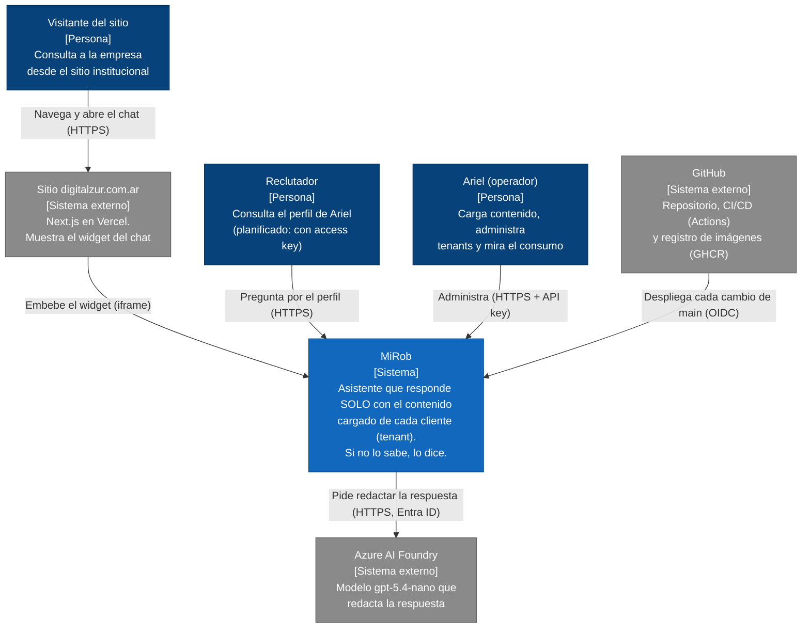
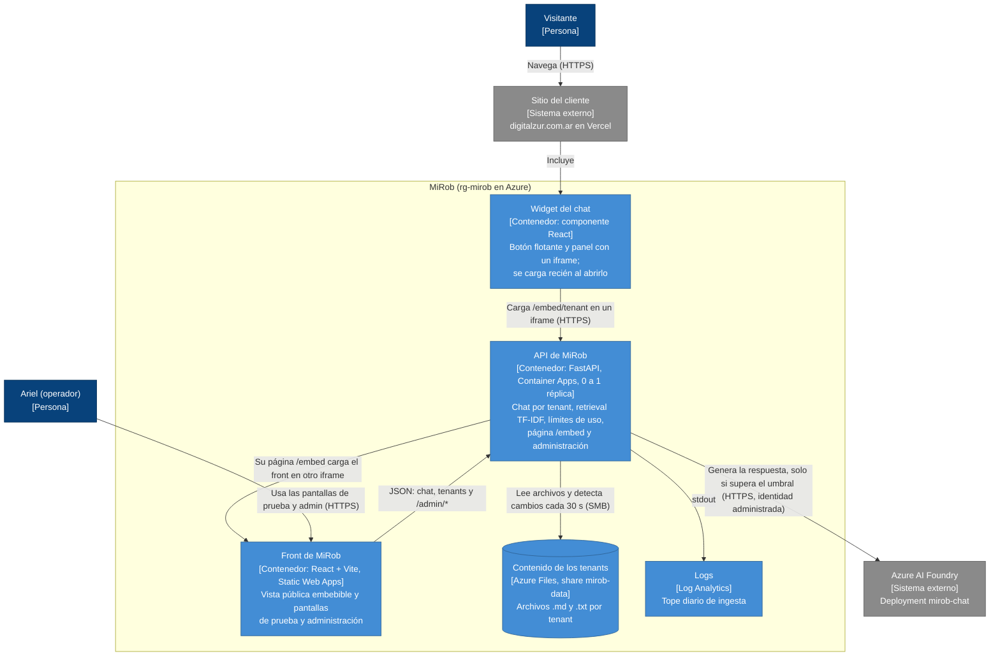
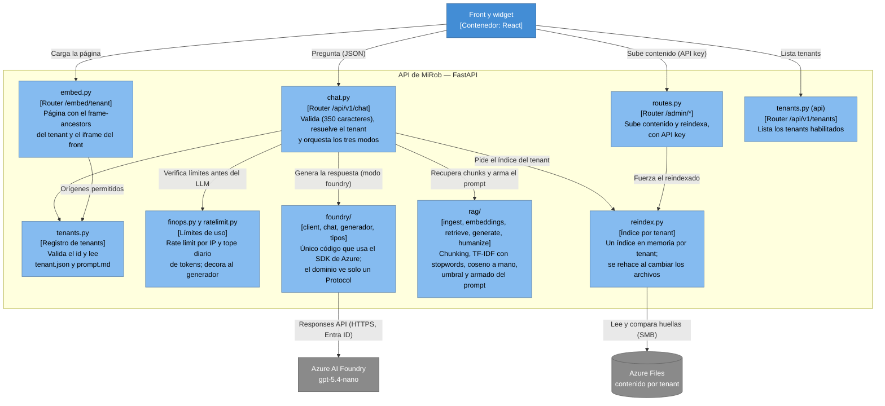
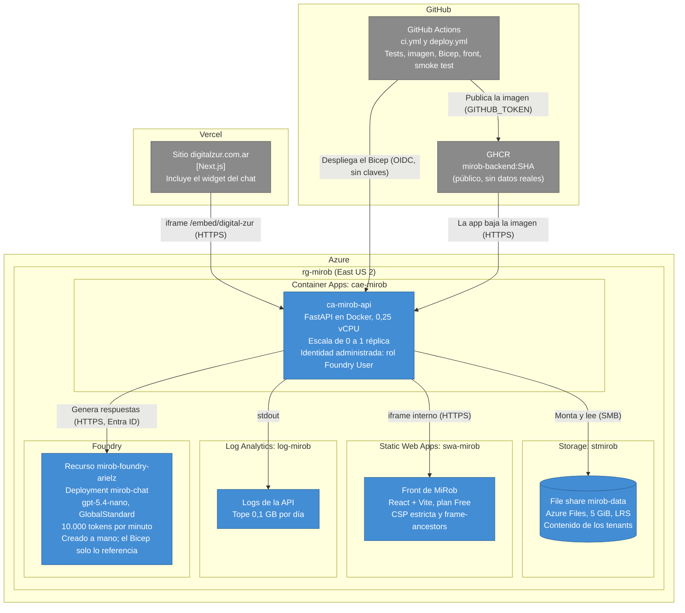
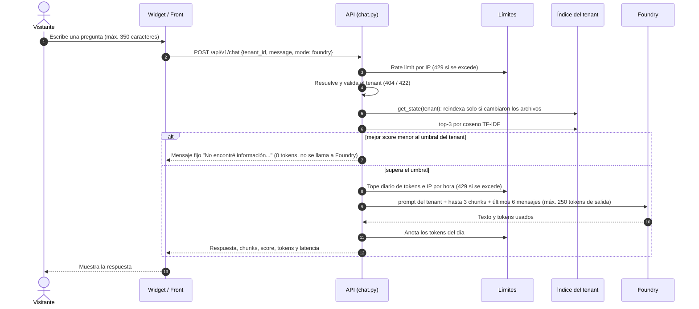
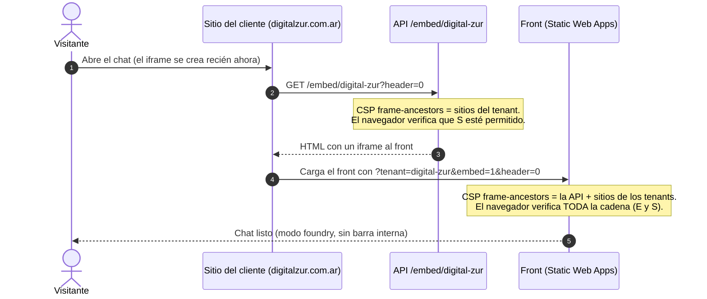
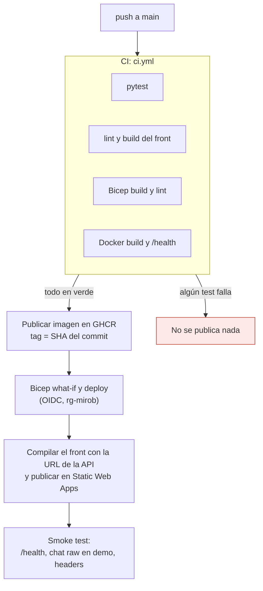

# MiRob — Arquitectura (modelo C4)

Los diagramas siguen el modelo C4 de Simon Brown: **contexto → contenedores → componentes → despliegue**. Están
escritos en [Mermaid](https://mermaid.js.org/): son texto versionado en git y GitHub los dibuja solo. Se usan diagramas
de flujo con la notación y los colores de C4 en lugar de la sintaxis C4 nativa de Mermaid, porque esta última
distribuye mal los elementos y superpone las etiquetas de las flechas.

Los motivos de cada decisión están en los [ADR](../adr/).

**Leyenda de colores:** azul oscuro = persona · azul = sistema o contenedor propio · celeste = componente ·
gris = sistema externo.

> Estado: lo descripto está desplegado y verificado en producción el 2026-10-23, salvo lo marcado como
> *planificado* (access keys para reclutadores, tenants dinámicos, consumo persistente).

## Nivel 1 — Contexto del sistema

Quién usa MiRob y con qué sistemas externos se relaciona.

## Nivel 2 — Contenedores

Las piezas ejecutables y los almacenes de datos que forman MiRob.

## Nivel 3 — Componentes de la API

Cómo está organizado el backend (`backend/app/`).

## Despliegue

Dónde corre cada pieza (definido en [`infra/main.bicep`](../../infra/main.bicep)).

## Flujo del chat (modo foundry)

El camino de una pregunta: dónde se corta para no gastar tokens.

## Flujo del widget embebido

La cadena de iframes y quién valida cada salto (ver [ADR 0007](../adr/0007-widget-embebible-y-cadena-de-iframes.md)).

## Flujo de CI/CD

De un push a producción (ver [ADR 0006](../adr/0006-cicd-github-actions-y-oidc.md)).

